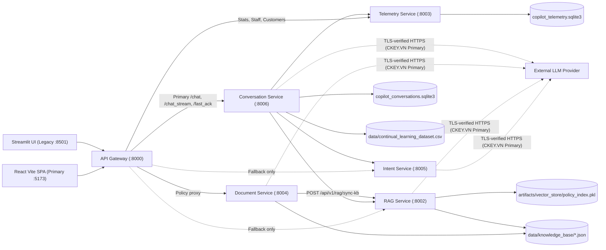
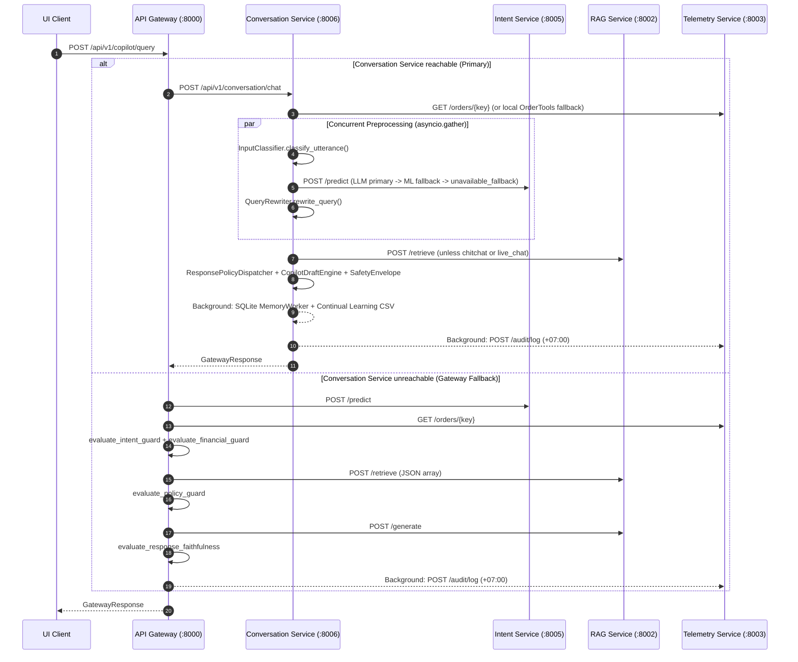
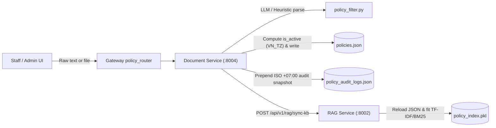

# E-commerce Support Copilot — Architecture Overview (v1)

> **Purpose:** Reference architecture document for coding agents and engineers working in `E-commerce-Support-Copilot`.
> **Epistemic Status Tags:** Every claim in this document is categorized as:
> - `Observed` — Directly verified in repository files, configuration, or schemas.
> - `Confirmed` — Explicitly confirmed by the project owner/user.
> - `Assumption` — Working technical assumption inferred from runtime setup; not a formal requirement.
> - `Proposed` — Suggested improvement or cleanup; **not** implemented and **not** an approved requirement.
> - `Open Decision` — Unresolved product or architectural question requiring owner direction.

---

## 1. Confirmed Architectural Decisions (`Confirmed`)

1. **Primary UI:** React/Vite (`frontend/`) is the official primary UI for ongoing development. Streamlit (`services/ui_service/`) is the legacy UI retained for reference and existing flows; do not delete Streamlit or alter `docker-compose.yml` UI deployment solely for this decision.
2. **Intent Classification:** `LLM primary -> ML fallback when LLM is unavailable -> safe human escalation`, using CKEY.VN (`LLM_PROVIDER=openai_compatible`, `OPENAI_BASE_URL=https://api.xah.io/v1`, `OPENAI_MODEL=vantoanbk57/deepseek-v4.1-flash`, `INTENT_BACKEND=llm`). ML is used as fallback only when a local ML artifact is validly loaded; if both LLM and ML are unavailable, the system fails closed and escalates to human support without silently switching to Gemini or another provider.
3. **Time Handling:** Remove the artificial `+12 hours` shift and restore real Vietnam time (`Asia/Ho_Chi_Minh`, `UTC+07:00`) using timezone-aware ISO 8601 timestamps for new records and explicit UTC vs. `Asia/Ho_Chi_Minh` reconciliation for legacy naive rows. Historical persisted timestamps are **not** batch-migrated or overwritten.
4. **TLS Security:** Enable TLS certificate verification (`verify=True`) by default across HTTP clients (`contracts/llm_failover.py`, `llm_classifier.py`, `generator.py`, `copilot_draft_engine.py`), with optional CA bundle support via standard environment variables (`LLM_CA_BUNDLE` / `REQUESTS_CA_BUNDLE` / `SSL_CERT_FILE`). Never use `verify=False` as a workaround.
5. **Git Workflow (Proposed/Confirmed Branch Convention):**
   - `main`: stable branch
   - `refine`: current integration branch
   - `feature/*`, `fix/*`, `docs/*`: scoped working branches

---

## 2. System Overview & Component Responsibilities (`Observed`)

The system is a multi-service Vietnamese/English E-commerce Customer Support Copilot with human-in-the-loop review, deterministic policy/financial guardrails, SQLite persistence, and dual UI clients.

| Component | Default Port (Local / Docker Host) | Entrypoint / Key Modules | Primary Responsibilities (`Observed`) |
| --- | --- | --- | --- |
| **React/Vite SPA (Primary UI)** | `5173` / N/A (not in Compose) | `frontend/src/`, `frontend/vite.config.ts` | Official primary TypeScript/React UI (`npm run dev` on `:5173`) proxying `/api` to `VITE_API_URL` (default `http://127.0.0.1:8000`), including SSE streaming (`/query_stream`) and RBAC customer/staff views. |
| **Streamlit UI (Legacy UI)** | `8501` / `8501` | `services/ui_service/src/app.py`, `views/` | Legacy workbench UI retained in Docker Compose & `run_dev.py` (Chat, Policy Management, Audit Notifications, Telemetry) communicating with `gateway` via `GATEWAY_URL`. |
| **API Gateway** | `8000` / `8000, 18000` | `services/gateway/src/main.py`, `clients.py`, `guardrails.py`, `routers/` | Central HTTP ingress (`/api/v1/copilot/*`); proxies dialogue to `conversation_service` with standalone degraded fallback; proxies policy CRUD (`policy_router.py`) and staff/customer RBAC views (`rbac_router.py`); hosts shared guardrail logic. |
| **Conversation Service** | `8006` / `18006` | `services/conversation_service/src/main.py`, `dialogue_state/`, `input_pipeline/`, `policies/`, `memory/` | Primary multi-turn dialogue orchestrator (`/chat`, `/chat_stream` SSE, `/fast_ack`); concurrent preprocessing (`asyncio.gather` for input classification, intent prediction, query rewriting); session & turn SQLite persistence; order matching; draft generation; runtime safety envelope; background continual-learning CSV export. |
| **Intent Service** | `8005` / `18005` | `services/intent_service/src/main.py`, `predictor.py`, `llm_classifier.py`, `normalizer.py`, `router.py` | Bilingual intent classification (`POST /predict`) across 16 `TARGET_INTENTS` + `out_of_scope` (`pipeline/dataset.py`). Enforces `LLM primary -> ML fallback -> unavailable_fallback` in `llm`/`hybrid` modes, plus pure offline `ml` mode. |
| **RAG Service** | `8002` / `18002` | `services/rag_service/src/main.py`, `retriever.py`, `indexer.py`, `generator.py`, `search_experiments.py` | Policy retrieval (`POST /retrieve`) and grounded draft generation (`POST /generate`), plus KB re-indexing (`POST /api/v1/rag/sync-kb` / `/ingest`). Default retrieval method is `bm25` (also supports `tfidf`, `dense`, `hybrid`, `reranked`). |
| **Document Service** | `8004` / `18004` | `services/document_service/src/main.py`, `policy_manager.py`, `policy_filter.py`, `routers/document_router.py` | Policy lifecycle CRUD, raw text & file parsing (`.docx`, `.pdf`, `.txt`, etc.) via LLM/heuristic filter, automatic `is_active` calculation against Vietnam calendar date (`get_vn_today`), policy audit trail, version rollback, and RAG KB sync trigger. |
| **Telemetry Service** | `8003` / `18003` | `services/telemetry_service/src/main.py`, `database.py`, `repository.py`, `cache.py`, `metrics.py` | SQLite persistence & LRU-cached lookup for orders (`/orders/*`), interaction audit logs (`/audit/log`, `/audit/action`, `/audit/stats`), Levenshtein edit distance & rubber-stamping metrics, and staff/customer profiles (`/staff`, `/customers`). |
| **Shared Contracts** | Library | `contracts/schemas.py`, `contracts/llm_failover.py` | Shared Pydantic v2 DTOs, canonical Vietnam timezone helpers (`VN_TZ`, `get_vn_now`, `get_vn_today`, `get_system_now`), and TLS-verified OpenAI-compatible multi-key HTTP/SSE failover client. |

### Overall Architecture Diagram (`Observed`)

---

## 3. Service Boundaries, Dependencies & API Contracts (`Observed`)

### 3.1 Inter-Service Communication & Boundaries

- **Gateway (`8000`)** is the single client-facing backend entrypoint:
  - Chat & sessions: `/api/v1/copilot/query`, `/api/v1/copilot/query_stream` (SSE), `/api/v1/copilot/fast_ack`, `/api/v1/copilot/sessions`, `/api/v1/copilot/session*`, `/api/v1/copilot/message` -> proxied to `conversation_service`.
  - Policy management (`services/gateway/src/routers/policy_router.py`): `/api/v1/copilot/policy/*` and `/api/v1/copilot/policies*` -> proxied to `document_service`.
  - Staff & customer RBAC views (`services/gateway/src/routers/rbac_router.py`): `/api/v1/copilot/staff*` -> `telemetry_service`; `/api/v1/copilot/customers/{id}/overview` aggregates `telemetry_service` (`/customers/{id}`, `/orders/customer/{id}`) and `conversation_service` (`/api/v1/conversation/sessions`).
  - Telemetry & evaluation: `/api/v1/copilot/action`, `/api/v1/copilot/stats` -> `telemetry_service`; `/api/v1/copilot/evaluation/*` runs `evaluation.evaluation_runner.EvaluationRunner` in-process inside Gateway.
- **Conversation Service (`8006`)** owns multi-turn dialogue state, input classification (`InputClassifier`), contextual query rewriting (`QueryRewriter`), order entity matching (`OrderMatcher` + `OrderTools`), acknowledgement generation (`CustomerAcknowledgementEngine`), response dispatching (`ResponsePolicyDispatcher`), and streaming/non-streaming copilot draft generation (`CopilotDraftEngine`).
  - *Cross-boundary coupling (`Observed`):* `services/conversation_service/src/main.py` directly imports `append_single_interaction_to_csv` from `scripts/export_continual_learning_dataset.py` and reads `data/mock_orders.json` directly via `OrderTools` as a local fallback when `telemetry_service` returns no order.
- **Intent Service (`8005`)** implements `LLM primary -> ML fallback -> safe human escalation`:
  - `IntentPredictor.predict()` prioritizes `LLMIntentClassifier` (CKEY.VN OpenAI-compatible) in `llm`/`hybrid` modes, preserving valid LLM decisions (including `out_of_scope`) without ML override.
  - When `LLMIntentClassifier` is unavailable (missing credentials, HTTP/network error, or invalid JSON -> internal `semantic_rule_fallback`), `IntentPredictor` falls back to `_predict_ml()` **only if** `has_ml_artifacts` is True (`backends` or `legacy_model` loaded).
  - If neither LLM nor ML artifacts are available (in normal runtime where `DISABLE_EXTERNAL_LLM` is not enabled), `IntentPredictor` returns `IntentPredictionResponse(intent="unknown_query", confidence=0.0, is_in_scope=False, model_name="unavailable_fallback")`.
  - Both `gateway` (`evaluate_intent_guard`) and `conversation_service` (`execute_dialogue_preprocessing` + `ResponsePolicyDispatcher`) treat `unavailable_fallback` or unreachable `intent_service` as fail-closed (`ESCALATE_HUMAN`, `allow_llm=False`), even on multi-turn sessions with a prior `active_intent` or `DISABLE_CONFIDENCE_GUARD=true`.
  - Explicit `DISABLE_EXTERNAL_LLM=true` isolation mode preserves offline test isolation (`_predict_ml` in `hybrid` if loaded, or `semantic_rule_fallback` for offline behavioral/isolation suites).
- **RAG Service (`8002`)** owns policy indexing/retrieval and policy-grounded draft generation (`POST /generate`). In the **primary** flow, `conversation_service` calls `rag_service /retrieve` for citations and generates drafts via `CopilotDraftEngine`, whereas `gateway` **fallback** calls both `rag_service /retrieve` and `rag_service /generate`.
- **Document Service (`8004`)** owns the canonical JSON policy store and policy audit log; after mutations (`create`, `update`, `delete`, `rollback`, `sync-active-status`), it notifies `rag_service` via `POST /api/v1/rag/sync-kb`.
- **Telemetry Service (`8003`)** owns `copilot_telemetry.sqlite3`, an in-memory `OrderLRUCache` (default size `256`), and production telemetry endpoints (`/audit/stats`, `GET /audit/drift` reading `recent_records`, `POST /audit/shadow/evaluate`).

### 3.2 Key Shared Contracts (`contracts/schemas.py`)

| Contract Model | Producer -> Consumer | Key Fields / Notes (`Observed`) |
| --- | --- | --- |
| `QueryRequest` | UI -> Gateway -> Conversation Service | `query`, `session_id` (UUID default), `customer_id`. |
| `IntentPredictionResponse` | Intent Service -> Conversation / Gateway | `intent`, `confidence` (`[0, 1]`), `is_in_scope`, `language`, `model_name` (records actual backend/model used, e.g. `vantoanbk57/deepseek-v4.1-flash`, `legacy_baseline`, `semantic_rule_fallback`, `unavailable_fallback`), `latency_ms`, `all_probabilities`. |
| `RetrievedDocument` | RAG / Document Service -> Consumers | `doc_id`, `category`, `title`, `content`, `version`, `is_active`, `policy_type` (`permanent` \| `temporary` \| `superseded`), `effective_date`, `expiration_date`, `tags`, `score`. |
| `POST /retrieve` response | `rag_service` -> `conversation_service` / `gateway` | Returns JSON array `List[RetrievedDocument]`. `MicroserviceClients.retrieve_policies` accepts both JSON array and legacy `{"documents": [...]}`. |
| `RAGGenerateRequest` / `Response` | Gateway -> `rag_service /generate` | Request: `query`, `citations`. Response: `draft_text`, `citations`, `latency_ms`, `generation_mode`, `fallback_reason`. |
| `GatewayResponse` | Conversation / Gateway -> UI | `interaction_id`, `intent`, `guardrail`, `citations`, `draft_text`, `order_data`, `tool_calls`, `generation_mode`, `suggested_reply`, `agent_guidance`, `input_type`, `active_facts`, `is_live_chat`, `customer_acknowledgement`, `session_turns`, `context_summary`, `retrieval_status`, `circuit_breaker_tripped`, `components_used`, `rewritten_query`. |
| `AuditLogCreate` / `HumanActionUpdate` | Gateway / Conversation / UI -> Telemetry | `HumanActionUpdate.action` is `Literal["APPROVE", "EDIT", "REJECT", "ESCALATE"]`. |

---

## 4. Core Runtime Flows (`Observed`)

### 4.1 Primary & Fallback Copilot Query Flow (`POST /api/v1/copilot/query`)

*Streaming path (`Observed`):* `POST /api/v1/copilot/query_stream` proxies SSE events (`event: meta`, `event: token`, `event: done`) from `conversation_service /api/v1/conversation/chat_stream`, and falls back to synthesizing 3 SSE events (`meta`, single `token`, `done`) from `process_copilot_query` if streaming fails.

### 4.2 Policy Lifecycle & Knowledge Base Synchronization

---

## 5. Storage, Databases & Time Handling (`Observed`)

### 5.1 Storage Inventory

| Store / Artifact | Engine / Format | Owner Service(s) | Docker Path / Local Default | Notes (`Observed`) |
| --- | --- | --- | --- | --- |
| **Telemetry & Orders DB** | SQLite (WAL mode) | `telemetry_service` | `/app/db_storage/copilot_telemetry.sqlite3` / `./copilot_telemetry.sqlite3` | Tables: `telemetry_logs`, `orders`, `staff`, `customers`. Auto-migrates from `data/mock_orders.json` if `orders` is empty and auto-seeds staff/customers on startup. |
| **Conversations DB** | SQLite (WAL mode) | `conversation_service` | `/app/db_storage/copilot_conversations.sqlite3` / `./copilot_conversations.sqlite3` | Tables: `conversation_sessions`, `conversation_turns`. Note: `data/copilot_conversations.sqlite3` also exists in the repository. |
| **Policy Knowledge Base** | JSON array | `document_service` (rw), `rag_service` (ro) | `data/knowledge_base/policies.json` | Observed 52 total policy records (49 `is_active=True`, including `POL-BRAND-001`). |
| **Policy Audit Logs** | JSON array | `document_service` | `data/knowledge_base/policy_audit_logs.json` | Stores `CREATE`, `UPDATE`, `SUPERSEDE`, `AUTO_EXPIRE`, `AUTO_ACTIVATE`, `ROLLBACK`, `DELETE` snapshots (latest first). |
| **Mock Orders Seed** | JSON array | `telemetry_service`, `conversation_service` | `data/mock_orders.json` | Observed 100 order records. Used both for SQLite seeding and `OrderTools`/`OrderMatcher` local lookup. |
| **Vector Index** | `joblib` pickle | `rag_service` | `artifacts/vector_store/policy_index.pkl` | Stores `TfidfVectorizer`, `documents`, and `doc_matrix`; rebuilt on `rag_service` startup (`lifespan`) and `/sync-kb`. |
| **Continual Learning CSV** | CSV | `conversation_service` -> `scripts/export_continual_learning_dataset.py` | `data/continual_learning_dataset.csv` | Appended in background on every `/chat` and `/chat_stream` request. |
| **Intent Model Artifacts** | Directory / `.joblib` / `.onnx` / `.pkl` | `intent_service` | `artifacts/models/intent/` (empty except `.gitkeep`), `artifacts/models/intent_model.pkl`, `artifacts/models/legacy_linearsvc_en/`, `ML-model/` | `artifacts/models/intent/deployment.env` is absent; `_load_legacy_model()` can fall back to `ML-model/` or `artifacts/models/intent_model.pkl` (trained on sklearn `1.6.1`, producing `InconsistentVersionWarning` under sklearn `1.9.1`). |

### 5.2 Timezone & Timestamp Convention (`Observed`)

- **Canonical Clock (`contracts/schemas.py`):** `VN_TZ` resolves `ZoneInfo("Asia/Ho_Chi_Minh")` (with `timezone(timedelta(hours=7))` fallback if OS tzdata is absent). `get_vn_now()`, `get_vn_today()`, and `get_system_now()` emit real Vietnam time (`UTC+07:00`) with **no `+12 hours` shift**.
- **New Writes Format:**
  - `conversation_service` (`PersistentStateStore`, `ConversationState`, `ConversationSessionState`), `telemetry_service` (`TelemetryRepository.insert_audit_log`, `cancel_order`), and `document_service` (`policy_audit_logs.json`) write timezone-aware ISO 8601 strings (`YYYY-MM-DDTHH:MM:SS+07:00`).
  - `PersistentStateStore.get_full_session_details()` extracts `"HH:MM"` (`created_at[11:16]`), compatible with both legacy `"YYYY-MM-DD HH:MM:SS"` rows and `"YYYY-MM-DDTHH:MM:SS+07:00"` rows.
  - Temporal policy date checks (`gateway/src/guardrails.py` and `document_service/src/policy_manager.py`) default `reference_date` to `get_vn_today()`.
  - `scripts/export_continual_learning_dataset.py` writes `created_at` in `Asia/Ho_Chi_Minh` (`%Y-%m-%d %H:%M:%S`) to preserve existing CSV column format.
- **Mixed Legacy History Handling (`Observed`, historical records untouched):**
  - Historical records in `copilot_conversations.sqlite3`, `copilot_telemetry.sqlite3`, `policy_audit_logs.json`, and `continual_learning_dataset.csv` were **not** modified or migrated.
  - `TelemetryRepository.get_stats()` and `get_continual_learning_pool()` sort candidate rows in Python by parsed UTC instant (interpreting legacy naive `telemetry_logs.timestamp` rows from SQLite `CURRENT_TIMESTAMP` as UTC and new ISO `+07:00` rows by exact offset) so midnight boundaries and mixed history order accurately.
  - `PersistentStateStore.list_sessions()` and `list_sessions_by_customer()` sort sessions in Python by parsed `VN_TZ` timestamp across legacy naive rows and ISO `+07:00`/`Z` rows.
  - `frontend/src/lib/time.ts` formats all timezone-aware timestamps in `Asia/Ho_Chi_Minh`; `TelemetryDashboardView.tsx` passes `{ assumeUtcForNaive: true }` so legacy naive UTC `telemetry_logs` rows convert cleanly to `UTC+07:00`, while naive wall-clock strings in `policy_audit_logs` are not erroneously shifted.

---

## 6. External LLM Providers & TLS Security (`Confirmed` & `Observed`)

### Confirmed Primary Provider (`Confirmed`)
- **Provider:** CKEY.VN (`LLM_PROVIDER=openai_compatible`) via `https://api.xah.io/v1`
- **Model:** `vantoanbk57/deepseek-v4.1-flash`
- **Intent Backend:** `INTENT_BACKEND=llm` (`LLM primary -> ML fallback -> safe human escalation`)

### Configuration & TLS Audit (`Observed`, secrets redacted)

1. **Unified Configuration Defaults (`Observed`):**
   - `.env`, `.env.example`, `docker-compose.yml`, `intent_service`, `conversation_service`, `rag_service`, and `document_service` align on `LLM_PROVIDER=openai_compatible`, `OPENAI_BASE_URL=https://api.xah.io/v1`, `OPENAI_MODEL=vantoanbk57/deepseek-v4.1-flash`, and `INTENT_BACKEND=llm`.
   - `.env` provides non-empty `OPENAI_API_KEY`, `OPENAI_API_KEY_BACKUP`, `OPENAI_API_KEYS`, and `GEMINI_API_KEY` (exact values withheld).
   - When `LLM_PROVIDER=openai_compatible`, `LLMIntentClassifier`, `LLMGenerator`, and `CopilotDraftEngine` do **not** silently fall back to Gemini if CKEY.VN is unavailable.
   - `frontend/src/features/chat/ChatView.tsx` and `conversation_service/src/main.py` no longer hardcode `"openai-gpt-oss-20b"`.
   - *Remaining minor note (`Observed`):* `docker-compose.yml` still sets differing per-service `GEMINI_MODEL` fallbacks (`gemini-2.5-flash` vs `1.5-flash` vs `flash-lite-latest`, only active if `LLM_PROVIDER=gemini|auto`), and standalone services outside `run_dev.py`/Compose rely on process env injection (except `document_service` and `rag_service/src/generator.py` which read `.env`).
2. **Failover & Offline Isolation (`contracts/llm_failover.py`) (`Observed`):**
   - Keys are read strictly from environment variables (`OPENAI_API_KEYS`, `OPENAI_API_KEY`, `OPENAI_API_KEY_BACKUP`); hardcoded `DEFAULT_KEYS` are absent.
   - `DISABLE_EXTERNAL_LLM=1|true|yes` short-circuits `get_available_api_keys()` to `[]`.
   - Retries across keys on HTTP `401`, `402`, `429`, `500`, `502`, `503` or connection exceptions.
3. **TLS Verification Enabled by Default (`Observed`):**
   - Zero `verify=False` remains in `services/`, `contracts/`, `scripts/`, or `evaluation/`.
   - `get_tls_verify_for_requests()` and `get_tls_verify_for_httpx()` return `True` by default, and support optional custom CA bundle paths via `LLM_CA_BUNDLE`, `REQUESTS_CA_BUNDLE`, or `SSL_CERT_FILE` (failing closed with `FileNotFoundError` if missing).
   - *Unverified Online Check (`Pending`):* Live TLS handshake verification against `https://api.xah.io/v1` was **not** executed due to offline constraints and requires verification in an authorized online environment.

---

## 7. Verified Business Rules & Architectural Invariants (`Observed`)

1. **Fail-Closed Financial Boundary:**
   - `FINANCIAL_INTENTS = {"request_refund", "payment_issue"}` (`gateway/src/config.py`, `conversation_service/src/config.py`) always block LLM generation and return `action_type="DIRECT_REFUND_FORM"` (`allow_llm=False`).
   - Runtime safety envelope (`gateway/src/guardrails.py` & `conversation_service/src/policies/safety_guard.py`) blocks generated drafts promising monetary refunds/compensation unless `order_data.status` is in `{"REFUND_PENDING", "CANCELLED", "RETURN_APPROVED"}`.
   - Human `APPROVE`/`EDIT` actions record audit metrics only; they do not send customer messages or execute financial transactions.
2. **Intent Scope, Fallback & Confidence Gate:**
   - Out-of-scope queries, explicit `human_agent` requests, `unknown_query` / `unavailable_fallback`, invalid/NaN confidence, or confidence `< INTENT_CONFIDENCE_THRESHOLD` (`0.60` default, unless `DISABLE_CONFIDENCE_GUARD=true`) escalate to human (`ESCALATE_HUMAN`).
   - `unknown_query` / `is_in_scope=False` is never bypassed even when `DISABLE_CONFIDENCE_GUARD=true` or when prior `active_intent` exists in a session.
3. **Temporal & Superseded Policy Guard (`guardrails.py` & `policy_manager.py`):**
   - `policy_type="superseded"` is **always** blocked/inactive regardless of `is_active` or dates.
   - `is_active=False` blocks all policy types.
   - `policy_type="temporary"` requires valid `effective_date` and `expiration_date` and blocks outside `[effective_date, expiration_date]` evaluated against `get_vn_today()`.
   - `policy_type="permanent"` ignores missing `expiration_date`.
4. **Prompt Injection Defense:**
   - Regex-based detection in `evaluate_prompt_injection()` blocks jailbreak/system-prompt extraction attempts pre-generation (`ResponsePolicyDispatcher` Case `-1`) and post-generation (`evaluate_runtime_safety_envelope`) with `is_hard_fail=True`.
5. **Response Faithfulness Gate (Gateway Fallback):**
   - `evaluate_response_faithfulness()` checks claim grounding/numeric consistency against citations and `order_data` against `FAITHFULNESS_THRESHOLD` (`0.70` default).
6. **Human Review Audit Integrity (`telemetry_service/src/repository.py`):**
   - `APPROVE` and `EDIT` require non-empty `final_text`; `update_human_action()` computes normalized Levenshtein distance and flags potential rubber-stamping (`detect_rubber_stamping`).

---

## 8. Implementation vs. Documentation & Contract Status (`Observed` & Reconciled)

| Area | Docs / Contracts Baseline | Current Implementation State (`Observed`) |
| --- | --- | --- |
| **UI Architecture** | `README.md` now presents React/Vite (`frontend/`, `:5173`) as the primary UI alongside legacy Streamlit (`:8501`). | `frontend/` (`:5173`) is the confirmed primary React/Vite SPA (`ADR-001`); Streamlit remains legacy in `services/ui_service/` and `docker-compose.yml` (`OD-001`). |
| **Conversation Service Port** | `services/conversation_service/src/main.py` docstring (lines 1, 69) says Port `8006`. | `conversation_service/src/config.py`, `docker-compose.yml`, and `run_dev.py` run it on Port **`8006`** (aligned). |
| **Module 1 Intent Artifacts** | `README.md` & `services/intent_service/README_MODULE1.md` expect trained artifacts in `artifacts/models/intent/`. | `artifacts/models/intent/` only contains `.gitkeep` (no Module 1 router deployed); `IntentPredictor._load_legacy_model()` falls back to legacy sklearn `1.6.1` artifacts in `ML-model/` or `artifacts/models/intent_model.pkl`. `/health` exposes `model_loaded`, `ml_artifacts_loaded`, and `intent_backend` (`OD-002`). |
| **Legacy DB Timestamp Rows** | Confirmed time convention uses Vietnam time (`UTC+07:00`). | New rows write explicit `+07:00`, while pre-existing SQLite/JSON/CSV rows remain unmigrated (`telemetry_logs` legacy rows are UTC naive; `conversation_sessions` & `policy_audit_logs.json` legacy rows are naive wall-clock) and are reconciled on read/sort/display (`OD-008`). |
| **GatewayResponse & TS Parity** | `contracts/schemas.py` defines `GatewayResponse`, `GuardrailResult`, and `IntentPredictionResponse`; `retrieval_status` documents `SUFFICIENT, INSUFFICIENT_EVIDENCE, EMPTY_RETRIEVAL`. | **Reconciled (`OD-007`):** `conversation_service/src/main.py` no longer passes dropped `session_id`/`latency_ms` kwargs to `GatewayResponse(...)` and emits `SUFFICIENT` / `INSUFFICIENT_EVIDENCE` / `EMPTY_RETRIEVAL`; `frontend/src/types/index.ts` includes `retrieval_status`, `circuit_breaker_tripped`, `is_hard_fail`, `violations`, and `all_probabilities`. |
| **Live Chat Handover Signature** | `gateway/src/clients.py` (`handover_session`) and `conversation_service` `/api/v1/conversation/handover`. | **Reconciled (`OD-007`):** `toggle_live_chat_handover` accepts both query params and JSON body, and `handover_session` aligns both query params and JSON payload (`test_handover_session_client_and_conversation_route_compatibility`). |
| **Circuit Breaker** | `services/gateway/src/circuit_breaker.py` defines `CircuitBreaker` and `GatewayResponse` includes `circuit_breaker_tripped`. | **Reconciled (`OD-007`):** `conversation_circuit_breaker` is wired into Gateway `/api/v1/copilot/query`, `/query_stream`, and `/health`, setting `circuit_breaker_tripped=True` on open fast-fail (`test_gateway_circuit_breaker_trips_and_fast_fails`). |
| **Retrieval Contract & Policy Count** | `README.md` cites `52` total / `49` active policies in `policies.json` (while noting the `47` active baseline of `data/retrieval_eval.json`). | `data/knowledge_base/policies.json` currently has `52` total / `49` active policies (added `POL-BRAND-001`); `rag_service/src/retriever.py` filters TF-IDF at `> 0.05` (no `0.50` cutoff for BM25) and falls back to `intent_doc_map` or `POL-CS-001` / `POL-ORD-001`. |

---

## 9. Assumptions, Proposed Follow-ups & Open Decisions

### Assumptions & ADRs
- Canonical unverified assumptions, evidence, impact, and verification plans are maintained in [docs/assumptions.md](../assumptions.md) (`ASM-001`..`ASM-007`).
- Confirmed architectural decisions are recorded in `docs/decisions/` ([ADR-001](../decisions/ADR-001-primary-ui-react-legacy-streamlit.md), [ADR-002](../decisions/ADR-002-intent-llm-primary-ml-fallback.md), [ADR-003](../decisions/ADR-003-vietnam-time-no-12h-offset.md), [ADR-004](../decisions/ADR-004-tls-verification-default-enabled.md)).
- Product requirements and implementable specifications live in [docs/product/requirements.md](../product/requirements.md), [docs/specs/intent-classification.md](../specs/intent-classification.md), and [docs/specs/copilot-workflow.md](../specs/copilot-workflow.md).

### Proposed Follow-up Tasks (`Proposed` — separate scoped plans required before execution)
1. **Module 1 ML Artifact Deployment (`OD-002`):** Train/deploy real Module 1 intent artifacts into `artifacts/models/intent/` matching the serving scikit-learn/ONNX runtime (avoiding legacy `1.6.1` pickle warnings) so ML fallback has full bilingual 16-intent coverage.
2. **Online TLS Verification (`OD-003`):** Verify `https://api.xah.io/v1` certificate chain in an authorized environment with live credentials (and set `LLM_CA_BUNDLE` if a custom/private CA is needed).
3. **Guardrail Calibration & Faithfulness Parity (`OD-005` — Resolved in code):** Unified `INTENT_CONFIDENCE_THRESHOLD = 0.60`, decoupled `is_intent_in_scope`, and shared `evaluate_response_faithfulness` / numeric-grounding parity across Gateway fallback and Conversation Service via `contracts/safety.py` (with real Module 1 ML validation cutoff remaining tied to `OD-002`).
4. **Historical Timestamp Migration (Optional, `OD-008`):** If unified historical SQL analytics are needed later, write a dedicated, reversible migration script for legacy rows in `copilot_telemetry.sqlite3`, `copilot_conversations.sqlite3`, `policy_audit_logs.json`, and `continual_learning_dataset.csv`.

### Open Decisions (`Open Decision` — requires owner confirmation)
1. **Docker Compose UI Target:** Keep `ui_service` (Streamlit) as the sole containerized UI in `docker-compose.yml` for now, or plan a dedicated task to containerize React (`frontend/`)?
2. **Module 1 ML Artifacts Roadmap:** Confirm when/whether trained Module 1 artifacts will be deployed into `artifacts/models/intent/` (mocked unit tests verify fallback logic only, not trained model quality).
3. **CKEY.VN (`https://api.xah.io/v1`) Certificate Chain:** Confirm via an authorized online check whether standard CA roots validate cleanly or `LLM_CA_BUNDLE` is required.
4. **Historical Timestamp Policy:** Confirm whether keeping legacy SQLite/JSON/CSV timestamps unmigrated (reconciled on read/sort/display) is sufficient long-term.
