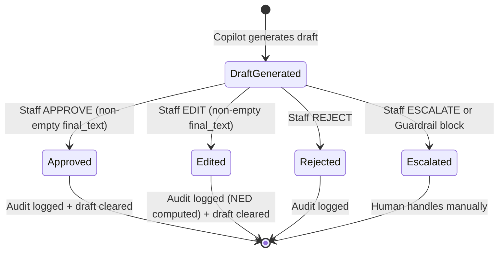

# Specification: Copilot End-to-End Workflow (`SPEC-WF-001`)

> **Linked Requirements:** `BR-001`..`BR-006`, `FR-UI-003`, `FR-UI-004`, `FR-DLG-001`, `FR-DLG-002`, `FR-RAG-001`, `FR-RAG-002`, `FR-ORD-001`, `FR-TEL-001`, `NFR-TIME-001`, `NFR-REL-001`, `SC-001`..`SC-007`
> **Linked ADRs:** [ADR-001](../decisions/ADR-001-primary-ui-react-legacy-streamlit.md), [ADR-002](../decisions/ADR-002-intent-llm-primary-ml-fallback.md), [ADR-003](../decisions/ADR-003-vietnam-time-no-12h-offset.md), [ADR-004](../decisions/ADR-004-tls-verification-default-enabled.md)
> **Primary Modules (`Observed`):** `services/gateway/src/main.py`, `clients.py`, `guardrails.py`; `services/conversation_service/src/main.py`, `policies/response_dispatcher.py`, `policies/copilot_draft_engine.py`, `policies/safety_guard.py`, `dialogue_state/sqlite_state_store.py`; `services/rag_service/src/main.py`, `retriever.py`, `generator.py`; `services/telemetry_service/src/repository.py`

---

## 1. Entrypoints & Contracts (`Observed Implementation`)

| Endpoint (Gateway `:8000`) | Primary Target | Fallback Behavior | Output Contract |
| --- | --- | --- | --- |
| `POST /api/v1/copilot/fast_ack` | `conversation_service /api/v1/conversation/fast_ack` | Instant polite Vietnamese buffer JSON | `{status, session_id, customer_acknowledgement, intent}` |
| `POST /api/v1/copilot/query` | `conversation_service /api/v1/conversation/chat` | Standalone Gateway degraded pipeline (`intent` -> `order` -> `guardrails` -> `rag /retrieve` -> `rag /generate`) | `GatewayResponse` |
| `POST /api/v1/copilot/query_stream` | `conversation_service /api/v1/conversation/chat_stream` (SSE) | Synthesizes `meta`, single `token`, `done` SSE events from `process_copilot_query()` | `text/event-stream` (`event: meta`, `token`, `done`) |
| `POST /api/v1/copilot/action` | `telemetry_service /audit/action` | Returns `HTTP 500` on telemetry failure | `{status: "recorded", interaction_id}` |

*Contract discrepancy (`Observed`, `OD-007`):* `conversation_service` passes `session_id` and `latency_ms` to `GatewayResponse(...)` (silently ignored by Pydantic) and sets `retrieval_status="FALLBACK"` (schema doc lists `SUFFICIENT, INSUFFICIENT_EVIDENCE, EMPTY_RETRIEVAL`). `frontend/src/types/index.ts` omits `retrieval_status`, `circuit_breaker_tripped`, `is_hard_fail`, `violations`, `all_probabilities`.

---

## 2. Primary Path Processing Rules (`Conversation Service`)

1. **Session & Early Order Association (`Observed Implementation`):**
   - Load/create session in `copilot_conversations.sqlite3` (`PersistentStateStore`, ISO `+07:00` timestamps).
   - Look up order via `telemetry_service GET /orders/{active_order_id or customer_id}`, falling back to local `OrderTools` (`data/mock_orders.json`) or cached session facts.
2. **Concurrent Preprocessing (`asyncio.gather`):**
   - `InputClassifier.classify_utterance()` -> `(input_type, new_facts, input_conf)`
   - `IntentServiceClient.predict_intent(targeted_query)` -> `IntentPredictionResponse`
   - `QueryRewriter.rewrite_query()` -> `(rewritten_query, rewrite_method)`
3. **Intent Fail-Closed Gate (`Confirmed Requirement` / `Observed Implementation`):**
   - If `intent_client` raises an error OR returns `model_name == "unavailable_fallback"` OR (`intent == "unknown_query"` and `not is_in_scope`): bypass `IntentTracker` carryover and set `final_intent_resp` to `unknown_query` (`0.0`, `is_in_scope=False`, `model_name="unavailable_fallback"`).
   - Otherwise, run `IntentTracker.resolve_intent_transition()` and update `state.active_intent`.
4. **Policy Retrieval (`Observed Implementation`):**
   - Unless `input_type == "chitchat"` or `state.is_live_chat`: call `rag_service POST /retrieve` (returns JSON array `List[RetrievedDocument]`). Record `has_expired_policy = any(not doc.is_active for doc in citations)`.
5. **Response Policy Dispatch (`ResponsePolicyDispatcher.dispatch`, priority order):**
   - **Case -1 (`Observed` / `Proposed`):** Prompt injection regex match -> `allow_llm=False`, `ESCALATE_HUMAN`, `is_hard_fail=True`, `blocked_security_guard`.
   - **Case 0 (`Observed` / `Proposed`):** Chitchat (`greeting`/`thanks`/`confirm`) -> `allow_llm=False`, `CHITCHAT_RESPONSE`, instant macro reply.
   - **Case 1 (`Observed` / `Proposed`):** `intent == "human_agent"` or `is_live_chat` -> `allow_llm=False`, `ESCALATE_HUMAN`, `live_chat_handover`.
   - **Case 2 (`Observed` / `Proposed`):** `intent in FINANCIAL_INTENTS` (`request_refund`, `payment_issue`) -> `allow_llm=False`, `DIRECT_REFUND_FORM`, `blocked_financial`.
   - **Case 2b (`Observed` / `Proposed`):** `out_of_scope` or off-topic keywords -> `allow_llm=False`, `ESCALATE_HUMAN`, `out_of_scope_abstain`.
   - **Case 3a (`Confirmed Requirement`):** `not is_in_scope` or `intent == "unknown_query"` -> `allow_llm=False`, `ESCALATE_HUMAN`, `blocked_intent_unavailable` (never bypassed by `DISABLE_CONFIDENCE_GUARD`).
   - **Case 3b (`Observed` / `Open Decision` `OD-005`):** `not DISABLE_CONFIDENCE_GUARD` and `confidence < 0.60` -> `allow_llm=False`, `ESCALATE_HUMAN`, `low_confidence_abstain`.
   - **Case 4 (`Observed` / `Proposed`):** `has_expired_policy` -> `allow_llm=False`, `ESCALATE_HUMAN`, `temporal_status="EXPIRED"`, `blocked_expired_policy`.
   - **Case 5:** `allow_llm=True`, `PROCEED_TO_LLM`.
6. **Draft Generation & Runtime Safety Envelope:**
   - If `not guard.allow_llm`: use macro/fallback draft.
   - If `guard.allow_llm`: call `CopilotDraftEngine.generate_draft()` (or `_stream()`). When `LLM_PROVIDER=openai_compatible`, calls CKEY.VN (`mainnewnol/gpt-oss-120b`); on failure, falls back to `_build_semantic_fallback_draft()` without calling Gemini.
   - Run `evaluate_runtime_safety_envelope()` (prompt injection + unauthorized monetary refund promise unless `order_data.status in {"REFUND_PENDING", "CANCELLED", "RETURN_APPROVED"}`). On violation, replace draft with safe holding response (`blocked_safety_envelope`).
7. **Persistence & Background Tasks (`Observed Implementation`):**
   - Save `copilot_draft` + response metadata in `conversation_sessions` (`+07:00`).
   - Background: `MemoryWorker.update_memory_task()`, `telemetry_client.record_audit_log()` (writes `+07:00` in `telemetry_logs`), and `append_single_interaction_to_csv()` (appends `data/continual_learning_dataset.csv`).

---

## 3. Gateway Standalone Fallback Rules (`Conversation Service` Unreachable)

1. Call `clients.predict_intent(query)`. On failure -> `unknown_query` (`0.0`, `is_in_scope=False`), `ESCALATE_HUMAN`.
2. Best-effort order lookup via `clients.lookup_order(order_match or customer_id)`.
3. Run `evaluate_intent_guard(intent_resp)` -> if blocked, return `blocked_intent_guard`.
4. Run `evaluate_financial_guard(intent)` -> if blocked (`DIRECT_REFUND_FORM`), return `blocked_financial_guard`.
5. Call `clients.retrieve_policies(..., filter_active_only=True)`:
   - **Contract (`Confirmed` / `Observed`):** Parses JSON array `[...]` from `rag_service /retrieve` (also accepts legacy `{"documents": [...]}`; raises `ValueError` on unexpected JSON shape, degrading to `citations=[]`).
6. Run `evaluate_policy_guard(citations)` (checks empty citations, `superseded`, `is_active=False`, and `temporary` dates against `get_vn_today()`) -> if blocked, return `blocked_policy_guard`.
7. Call `clients.generate_draft(query, citations)` (`rag_service /generate`, CKEY.VN primary -> deterministic template fallback, zero silent Gemini fallback under `openai_compatible`).
8. Run `evaluate_response_faithfulness(draft_text, citations, customer_query, order_data)` (`FAITHFULNESS_THRESHOLD=0.70`) -> if hallucination detected, set `generation_mode="blocked_faithfulness_guard"` while preserving draft for staff inspection.
9. Schedule background `clients.log_telemetry(audit_payload)`.

---

## 4. Human-in-the-Loop Review State Transitions (`Observed Implementation`)

- `POST /audit/action` rejects `APPROVE`/`EDIT` with empty `final_text` (`HTTP 422`), computes normalized Levenshtein distance (`edit_distance`), flags `is_rubber_stamping`, and marks `is_continual_learning`.

---

## 5. Failure Scenarios, Edge Cases & Known Gaps

| Scenario | Behavior | Status |
| --- | --- | --- |
| `conversation_service` down + `rag_service /retrieve` returns JSON array | Gateway fallback parses JSON array into `RetrievedDocument` list and generates grounded draft. | `Observed Implementation` (verified in `test_gateway_rag_fallback.py`) |
| `rag_service /retrieve` returns `[]` | Gateway fallback blocks with `blocked_policy_guard` (`ESCALATE_HUMAN`). | `Observed Implementation` |
| `conversation_service` receives `unavailable_fallback` on Turn 2 of active `track_order` session | Fails closed (`ESCALATE_HUMAN`), does not inherit Turn 1 `active_intent`. | `Confirmed Requirement` / `Observed Implementation` |
| Mixed legacy UTC + new `+07:00` timestamps across midnight | `TelemetryRepository` and `PersistentStateStore` sort chronologically in Python; `frontend/src/lib/time.ts` renders in `Asia/Ho_Chi_Minh`. | `Confirmed Requirement` / `Observed Implementation` |
| `evaluate_response_faithfulness` parity | Runs in Gateway fallback, **not** invoked in `conversation_service` primary path (which runs `evaluate_runtime_safety_envelope` instead). | `Observed Implementation` (`Open Decision` `OD-005`) |
| `CircuitBreaker` in Gateway | Implemented in `services/gateway/src/circuit_breaker.py` but not wired into live Gateway calls. | `Observed Implementation` (`Open Decision` `OD-007`) |

---

## 6. Acceptance Criteria

| ID | Verifiable Condition | Current Automated Evidence (`Observed`) |
| --- | --- | --- |
| `AC-WF-001` | Gateway fallback with mocked `httpx.MockTransport` parses `/retrieve` JSON array, passes policy guard, calls `/generate`, and returns citations + grounded draft. | `tests/test_gateway_rag_fallback.py::test_gateway_fallback_succeeds_when_rag_retrieve_returns_json_array` |
| `AC-WF-002` | Gateway fallback with `/retrieve` returning `[]` blocks via `blocked_policy_guard` (`ESCALATE_HUMAN`). | `tests/test_gateway_rag_fallback.py::test_gateway_fallback_blocks_when_rag_retrieve_returns_empty_array` |
| `AC-WF-003` | `conversation_service` and `gateway` both escalate (`ESCALATE_HUMAN`) when intent is `unavailable_fallback` or `intent_service` errors. | `tests/test_architecture_decisions_alignment.py` |
| `AC-WF-004` | Financial intents, expired/superseded policies, prompt injection, and hallucinated drafts in Gateway fallback are intercepted (`allow_llm=False`). | `tests/test_guardrails.py`, `tests/test_robustness.py`, `tests/test_mlip_evaluation.py` |
| `AC-WF-005` | When `LLM_PROVIDER=openai_compatible` and CKEY.VN keys are absent/failing, neither `LLMGenerator` nor `CopilotDraftEngine` calls Gemini. | `tests/test_architecture_decisions_alignment.py::test_openai_compatible_does_not_silently_fallback_to_gemini_in_rag_or_draft` |
