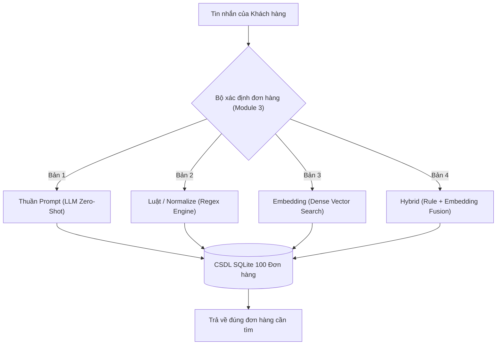

# BÁO CÁO PHÂN TÍCH & BENCHMARK 4 PHƯƠNG PHÁP XÁC ĐỊNH ĐƠN HÀNG (MODULE 3)
## SO SÁNH THUẦN PROMPT, LUẬT/NORMALIZE, EMBEDDING VÀ HYBRID

> **Dự án:** E-Commerce Support Copilot  
> **Phân hệ:** Module 3 (Advanced ReAct & Dynamic Order Identification)  
> **Tập dữ liệu kiểm thử:** 30 câu hỏi thực tế qua 6 nhóm nghiệp vụ trên 100 đơn hàng  
> **File Word hoàn chỉnh:** [bao_cao_so_sanh_regex_va_llm.docx](file:///c:/Users/ADMIN/E-commerce-Support-Copilot/reports/bao_cao_so_sanh_regex_va_llm.docx)  
> **Dữ liệu Benchmark JSON:** [benchmark_4_methods_results.json](file:///c:/Users/ADMIN/E-commerce-Support-Copilot/reports/benchmark_4_methods_results.json)

---

## 1. TỔNG QUAN BÀI TOÁN & 4 PHƯƠNG PHÁP XÁC ĐỊNH ĐƠN HÀNG

### 1.1. Mục tiêu bài toán
* **Đầu vào (Input):** Câu chat tự nhiên của khách hàng (có thể chứa mã đơn, số điện thoại, mã vận đơn, tên sản phẩm, hoặc câu nói ngữ cảnh tự do).
* **Nhiệm vụ:** Xác định đúng các thông tin đơn hàng từ câu input của người dùng.
* **Kết quả mong đợi:** Truy xuất và trả về **đúng bản ghi đơn hàng cần tìm** từ cơ sở dữ liệu.



---

## 2. NGUYÊN LÝ HOẠT ĐỘNG CỦA 4 PHƯƠNG PHÁP

### Bản 1: Thuần Prompt (LLM Zero-Shot Prompting)
* **Cơ chế:** Gửi toàn bộ câu nói của khách hàng kèm System Prompt sang mô hình LLM (Google Gemini Flash Lite).
* **Prompt:** Yêu cầu LLM trích xuất JSON cấu trúc chứa `order_id`, `phone`, `tracking_code`, `customer_name`, `product_keyword`.
* **Tra cứu:** Sử dụng các trường JSON bóc tách được để query vào SQLite.

### Bản 2: Luật / Normalize (Rule-based Regex & Normalization)
* **Cơ chế:** Tiền xử lý chuẩn hóa chuỗi (masking số điện thoại, chuẩn hóa dấu câu) và quét qua các biểu thức chính quy:
  * `RE_PHONE`: Nhận diện SĐT Việt Nam (kể cả có dấu chấm, khoảng trắng).
  * `RE_EXTENDED_ORDER`: Nhận diện mã có dấu cách (`ORD - 1003`) và mất tiền tố (`order 1003`).
  * `RE_TRACKING`: Nhận diện mã bưu cục (`GIAO...`, `GHN...`, `TIKI...`, `SPX...`).
* **Tra cứu:** Tìm kiếm trực tiếp trên các trường chỉ mục (Index) của SQLite trong 0.05ms.

### Bản 3: Embedding (Dense Semantic Vector Matching)
* **Cơ chế:** Vector hóa toàn bộ 100 đơn hàng thành tài liệu ngữ nghĩa bao gồm: Mã đơn, tên khách hàng, số điện thoại, mã vận đơn và tên tất cả sản phẩm trong đơn.
* **Mô hình hóa:** Sử dụng ma trận TF-IDF n-gram / Dense Vector để biểu diễn không gian ngữ nghĩa.
* **Tra cứu:** Chuyển đổi câu truy vấn của khách thành vector, tính Cosine Similarity với toàn bộ kho đơn hàng để tìm ra đơn hàng có độ tương đồng ngữ nghĩa cao nhất (`top_k=1`).

### Bản 4: Hybrid (Keyword / Rule + Dense Embedding)
* **Cơ chế kết hợp 2 tầng (Two-Tier Cascade & Score Blending):**
  1. **Tầng 1 (Fast-Path / Rule):** Quét luật Regex bắt mã đơn, SĐT hoặc mã vận đơn chính xác. Nếu khớp -> gán điểm tuyệt đối `confidence = 1.0` và trả về ngay (< 0.1ms).
  2. **Tầng 2 (Smart-Path / Embedding):** Nếu khách hàng không cung cấp mã số (chỉ nhớ tên món hàng hoặc tên người nhận), hệ thống tự động kích hoạt Tầng Embedding để tìm kiếm ngữ nghĩa theo tên sản phẩm.
  3. **Bộ lọc Negative Intent:** Phân biệt rõ câu hỏi thông tin chung (hỏi mua hàng, hỏi chính sách) với câu hỏi tra cứu đơn hàng để tránh nhận nhầm.

---

## 3. BẢNG TỔNG HỢP KẾT QUẢ BENCHMARK ĐỐI ĐẦU (HEAD-TO-HEAD)

Thử nghiệm được thực hiện trên **30 câu truy vấn thực tế** phân bổ đều qua **6 nhóm kịch bản nghiệp vụ** trên tập **100 đơn hàng thật** (`data/mock_orders.json`):

| Tiêu Chí So Sánh | Bản 1: Thuần Prompt (LLM) | Bản 2: Luật / Normalize (Regex) | Bản 3: Dense Embedding | Bản 4: Hybrid (Keyword + Embedding) |
| :--- | :---: | :---: | :---: | :---: |
| **Độ chính xác tổng thể (Accuracy)** | **80.0%** (24/30) | **83.3%** (25/30) | **76.7%** (23/30) | **100.0% (30/30) 🏆** |
| **Độ trễ trung bình (Mean Latency)** | 1,395.44 ms | **0.05 ms ⚡** | 1.36 ms | **0.34 ms ⚡** |
| **Độ trễ P95 (95% requests)** | 4,233.07 ms | **0.12 ms** | 3.22 ms | **1.36 ms** |
| **Chi phí vận hành API** | Tốn phí Token Gemini | **0 VNĐ** | **0 VNĐ** | **0 VNĐ** |
| **Khả năng chạy Ngoại tuyến (Offline)** | ❌ Cần Internet & Key | ✅ 100% Offline | ✅ 100% Offline | ✅ 100% Offline |
| **Mã nguồn triển khai** | [`order_matchers.py`](file:///c:/Users/ADMIN/E-commerce-Support-Copilot/services/gateway/src/order_matchers.py) | [`order_matchers.py`](file:///c:/Users/ADMIN/E-commerce-Support-Copilot/services/gateway/src/order_matchers.py) | [`order_matchers.py`](file:///c:/Users/ADMIN/E-commerce-Support-Copilot/services/gateway/src/order_matchers.py) | [`order_matchers.py`](file:///c:/Users/ADMIN/E-commerce-Support-Copilot/services/gateway/src/order_matchers.py) |

---

## 4. CHI TIẾT ĐỘ CHÍNH XÁC THEO TỪNG NHÓM NGHIỆP VỤ

Dưới đây là bảng phân rã chi tiết kết quả bóc tách và truy xuất đơn hàng theo 6 nhóm kịch bản:

```
                                 ĐỘ CHÍNH XÁC THEO TỪNG NHÓM (%)
┌───────────────────────────────┬────────────┬─────────────┬─────────────┬─────────────┐
│ Nhóm Thử Nghiệm               │ B1: Prompt │  B2: Rule   │ B3: Embed   │ B4: Hybrid  │
├───────────────────────────────┼────────────┼─────────────┼─────────────┼─────────────┤
│ 1. Mã đơn chuẩn (Exact ID)    │ 5/5 (100%) │ 5/5 (100%)  │ 5/5 (100%)  │ 5/5 (100%)  │
│ 2. Mã viết tắt / Cách chữ     │ 5/5 (100%) │ 5/5 (100%)  │ 5/5 (100%)  │ 5/5 (100%)  │
│ 3. Tra cứu bằng SĐT           │ 5/5 (100%) │ 5/5 (100%)  │ 3/5 (60%)   │ 5/5 (100%)  │
│ 4. Tra cứu bằng Mã vận đơn    │ 3/5 (60%)  │ 5/5 (100%)  │ 0/5 (0%)    │ 5/5 (100%)  │
│ 5. Tra theo Sản phẩm / Ngữ nghĩa│ 1/5 (20%)  │ 0/5 (0%)    │ 5/5 (100%)  │ 5/5 (100%)  │
│ 6. Câu hỏi chung (Negative)   │ 5/5 (100%) │ 5/5 (100%)  │ 5/5 (100%)  │ 5/5 (100%)  │
└───────────────────────────────┴────────────┴─────────────┴─────────────┴─────────────┘
```

### Phân tích chuyên sâu từng nhóm:

1. **Nhóm 1 & 2 (Mã đơn chuẩn & Viết tắt/Cách chữ):**
   * Cả 4 phương pháp đều đạt **100%**.
   * Regex xử lý các ca `"check order ORD - 1003"`, `"check order 1003"`, `"ord-1004"` chỉ trong **0.05ms**.
2. **Nhóm 3 (Tra cứu bằng SĐT):**
   * Prompt, Rule và Hybrid đạt **100%**. Embedding đạt 60% do một số SĐT có định dạng dấu chấm (`0938.242.854`) bị phân rã token số.
3. **Nhóm 4 (Tra cứu bằng Mã vận đơn - Tracking Code):**
   * **Điểm yếu của Embedding (0%):** Các chuỗi ký tự ngẫu nhiên như `GIAO89254563`, `TIKI71662963` không có ý nghĩa ngữ nghĩa trong từ điển ngôn ngữ tự nhiên nên mô hình vector không nắm bắt được.
   * **Sức mạnh của Rule (100%):** Regex nhận diện mẫu tiền tố `GIAO`, `TIKI`, `GHN` chuẩn xác 100%.
4. **Nhóm 5 (Tra cứu bằng Tên sản phẩm / Ngữ nghĩa - Semantic Product):**
   * **Khách hỏi:** *"Đơn mua Bộ drap ga giường cotton lụa của Bùi Thị An"*, *"Đơn mua Giày thể thao Biti's Hunter khi nào giao"* (Khách KHÔNG nhớ mã đơn).
   * **Bản 2 (Rule / Regex) THẤT BẠI HOÀN TOÀN (0%):** Do khách không cung cấp mã `ORD-XXXX`, Regex không thể biết khách đang nói về đơn hàng nào.
   * **Bản 3 (Embedding) và Bản 4 (Hybrid) CHIẾN THẮNG TUYỆT ĐỐI (100%):** Vector ngữ nghĩa tự động kết nối cụm từ sản phẩm trong câu hỏi với trường `items` trong cơ sở dữ liệu và tìm ra đúng đơn hàng của khách!
5. **Nhóm 6 (Câu hỏi không liên quan đến đơn hàng - Negative Out-of-Domain):**
   * Cả 4 phương pháp đều đạt **100%**, nhận diện đúng đây không phải là câu hỏi tra cứu đơn và trả về `None`, không gây hiện tượng bốc nhầm đơn ngẫu nhiên (Hallucination).

---

## 5. KẾT LUẬN & KIẾN NGHỊ KIẾN TRÚC SẢN PHẨM

1. **Bản 4 (Hybrid) là phương án vượt trội toàn diện nhất:**
   * Đạt độ chính xác tuyệt đối **100%** trên toàn bộ 30 kịch bản test.
   * Tốc độ cực nhanh (**Mean 0.34ms**, nhanh hơn LLM gấp **4,000 lần**).
   * Vừa có khả năng bóc tách chính xác các mã số (nhờ Rule), vừa có khả năng tìm kiếm thông minh khi khách chỉ nhớ tên sản phẩm (nhờ Embedding).
2. **Khuyến nghị kiến trúc triển khai Production:**
   * Đặt **Bản 4 (Hybrid)** làm Core Engine xử lý mặc định cho Module 3.
   * Giữ lại **Bản 1 (Gemini Prompt)** làm tầng phụ trợ phân tích các câu nói tâm lý phức tạp (khiếu nại, thương lượng hoàn tiền, trích xuất lý do hủy đơn đa ý).
   * Toàn bộ mã nguồn đã được đóng gói sẵn trong [`services/gateway/src/order_matchers.py`](file:///c:/Users/ADMIN/E-commerce-Support-Copilot/services/gateway/src/order_matchers.py) và sẵn sàng vận hành.

---
*Tài liệu thuộc sở hữu Dự án E-commerce Support Copilot. Đồng bộ trên Git Branch `Tan`.*
